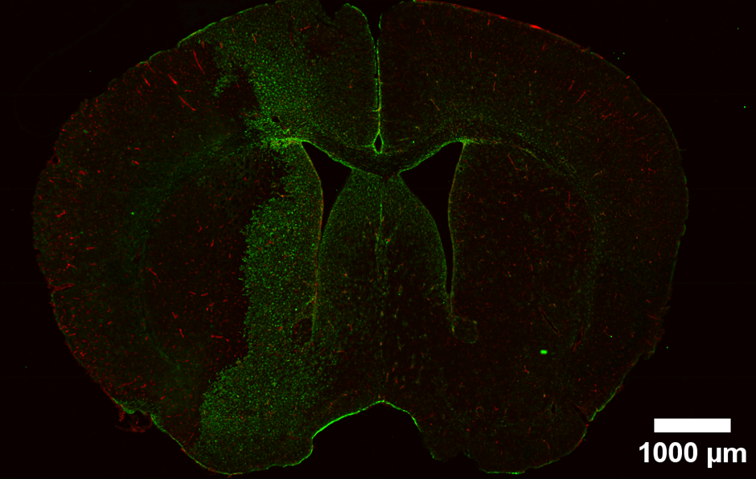
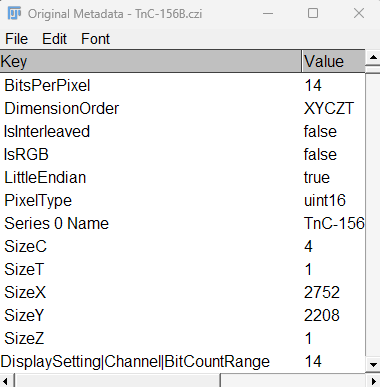

##  Principles of working with images {.center}

::: {layout-ncol="2" layout-valign="center"}

::: {style="text-align: center;font-size: 60%"}
{fig-align="left" width="500" height="300"}
:::

::: {style="text-align: center;font-size: 60%"}
-    When possible, convert [propietary files]{style="color:red;"} (i.e .czi) to [open formats]{style="color:green;"} with no compression (.tif).
-    Share [technical]{style="color:green;"} (acquisition parameters) and [descriptive]{style="color:green;"} (context and content) [metadata]{style="color:green;"} along with the images.
-    Use [FIJI, Python]{style="color:green;"} or related [coding/scripting software]{style="color:green;"} (prefered) to document image transformations (resize. background substraction, etc.).
-    Extract information/perform analysis using [coding/scripting software]{style="color:green;"} to ensure reproducibility. Please [avoid manual counts/analysis]{style="color:red;"}.
:::

:::

##  Transform images to open formats {.center}

::: {layout-ncol="2" layout-valign="center"}

::: {style="text-align: center;font-size: 60%"}
{fig-align="left" width="500" height="300"}
:::

::: {style="text-align: center;font-size: 70%"}
You can easy [transform]{style="color:green;"} your propietary files (.czi) to open formats (.tif) using i.e [FIJI]{style="color:green;"} [scripts](https://github.com/indepth-data/DataScience_Teaching/blob/main/resources/Transform_czi-tif.ijm).
:::

::: callout-caution
Saving .czi images as .tif using FIJI will result in [metadata loss]{style="color:red;"} (archived within the .czi file).
:::

:::

## Keep track of the metadata {.smaller}

::: {layout-ncol="2"}

###  [Technical]{style="color:gray;"}

Get the technical metadata from the .czi file as [.txt or .csv]{style="color:green;"} files (often for all images).

::: {style="text-align: center;font-size: 70%"}
{fig-align="center" width="300" height="300"}
:::

###  [Descriptive]{style="color:orange;"}

Generate a descritive readme explaining to understand the [provenance and naming conventions]{style="color:green;"} of the images.

::: {style="text-align: center;font-size: 70%"}
](images/DescriptiveMetadata_czi.png){fig-align="center" width="450" height="300"}
:::

:::